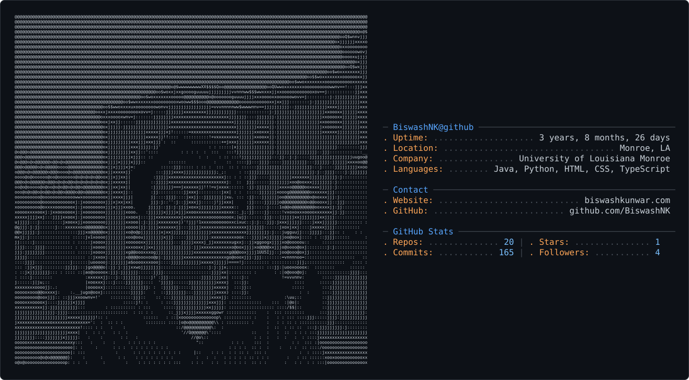

# Biswash Kunwar

**AI Engineer** · agents · automation · data pipelines

## Now

- AI Engineer at a 3PL / fulfillment company
- Building AI agents and copilots on top of warehouse and order data
- Automating ops work: invoicing, reporting, alerting

## Agents & AI

- **Claude Code**: daily driver, with custom mods, hooks and skills
- **MCP servers**: connecting agents to the data warehouse, Slack, Notion and internal tools
- **Team AI OS**: shared context and skills across Claude Code, Cursor and Codex
- **Hermes Agent**: self-hosted agent runtime
- **Grok Bot**: Cowork-style AI coworker on xAI Grok
- **Slack bots**: personal assistant bot plus client-facing copilots (quotes, shipping labels, order lookups)

## Data

- **BigQuery** as the warehouse
- **ShipHero** WMS data → BigQuery pipelines
- **Supabase / Postgres** for app data
- **Power BI** dashboards with API-driven refreshes
- **Next.js** dashboards and internal portals

## Cloud & DevOps

- **GCP**: Cloud Run, Cloud Functions, Cloud Scheduler, Cloud Monitoring, Secret Manager
- **GitHub Actions**: CI/CD with Workload Identity Federation, deploy only what changed
- **Docker** for local dev stacks
- Monorepo for Cloud Run services and functions

## Languages

- Python
- TypeScript / JavaScript
- SQL

## Setup

- **Ghostty** terminal plus a custom Claude Code "Tabs" pane
- **Notion** and **Slack** for team ops
