<picture>
  <source media="(prefers-color-scheme: dark)" srcset="assets/card_dark.svg" />
  <source media="(prefers-color-scheme: light)" srcset="assets/card_light.svg" />
  
</picture>

<picture>
  <source media="(prefers-color-scheme: dark)" srcset="assets/pipeline_dark.svg" />
  <source media="(prefers-color-scheme: light)" srcset="assets/pipeline_light.svg" />
  
</picture>

```text
~/now
├── agents that answer ops questions in Slack
├── client copilots ─── quotes · shipping labels · order lookups
├── GCP monorepo ────── deploy only what changed
└── team AI OS ──────── one shared context for Claude Code, Cursor and Codex
```

```text
~/desk
├── Ghostty + zsh
├── Claude Code with a custom "Tabs" pane
└── Notion · Slack
```

<sub>card and pipeline are generated SVGs · <code>python3 scripts/gen.py scripts/portrait.txt assets</code></sub>
